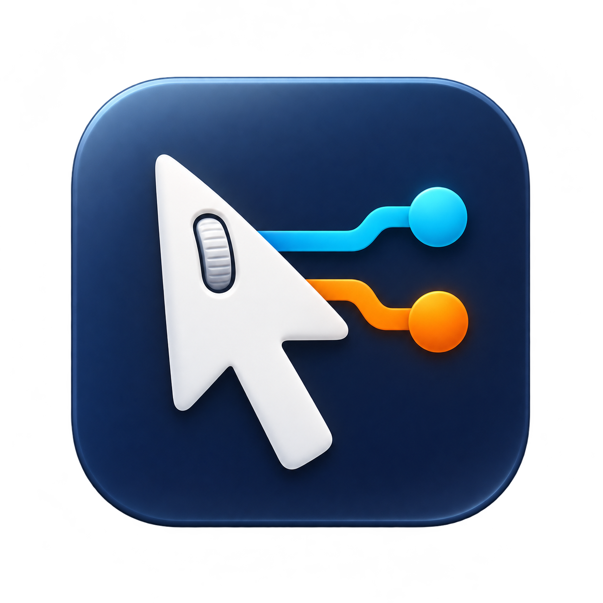

# HID Emu — Flipper Zero + Cardputer

One local Mac dashboard for supervised mouse control through either **Flipper Zero** or **M5Stack Cardputer ADV**. The connected device supplies USB mouse input; the Mac provides coordinates, application names and observed mouse activity to both dashboards. Mouse control stays local. Optional update checks contact this GitHub repository; installation starts only when selected.

| Component | Current release | Connection |
|---|---|---|
| HID Emu for macOS | 2.3.0, build 6 | One dashboard, selectable device |
| Cardputer ADV companion | 1.4.0 | USB; selectable in M5Launcher |
| Flipper Zero companion | 1.2.0 | Mac commands over Bluetooth; USB HID to host |

## Start

Download the [Mac app ZIP](releases/hid-emu-2.3/HID_Emu_macOS_2.3.0_build6.zip), or build and install on a Mac with Xcode command-line tools: `zsh unified/build.sh --install`. Open **HID Emu** from your Applications folder. Allow Bluetooth when using Flipper, and macOS mouse-monitoring permissions if requested for observation.

Choose **Automatic**, **Cardputer**, or **Flipper Zero**, then Connect. Automatic prefers a recognized Cardputer when both are available; otherwise it tries Flipper. Enter your Flipper's distinctive Bluetooth name once. Generic Espressif USB names require local enrollment of your Cardputer's serial using `HIDEmu --register-cardputer SERIAL`; the app does not claim every ESP32 as a Cardputer. `--list-devices` lists recognized Cardputer ports. Selection applies when connecting; changing devices requires disconnecting first. Commands are never replayed after reconnecting.

Viewing is available while disarmed. **Arm 60s** before sending input. **STOP** or **Command-period** requests release; Flipper disconnects and restores its normal USB interface. Reconnect and arm afresh for further commands. Cardputer also stops with **S** or **G0**; Flipper's physical **BACK** exits the companion. Close qFlipper and earlier controller apps before connecting.

## Dashboard

The version appears in the window title and header. The window opens at **760 × 620 points**; **View → Compact Window (⌘1)** uses **720 × 580**, and **⌘0** restores the default size. Consistent panel padding and aligned rows keep the core status visible. Connection settings live behind the sliders button; disconnect before changing the Bluetooth name or USB port.

The upper panels show pointer activity, readiness and arming, with a prominent red STOP. The application strip shows the active app, the app beneath the pointer and the last observed action. **Activity**, **Apps** and **Display** tabs share the lower panel. Command entry and the **Overlay** / **Device screen** switches stay available in every tab. The footer reports connection status. [Compact interface design and verification](docs/HID-Emu-Compact-UI-2026-11-18.md).

- Current coordinates, active app and app beneath the pointer, command replies and session uptime.
- Clean blue/slate Mac and Cardputer screens; matching compact monochrome Flipper layout.
- Ten recent distinct positions in an aspect-fitted radar trail with a direction arrow. This is a relative trajectory centered on the newest point, not an absolute desktop map.
- Left/right/middle button indicators, clicks and double clicks, dragging and wheel activity. Directional anchors follow a clockwise spectrum: **up amber, right green, down blue, left violet**. Left/right clicks use their corresponding side color; wheel movement lights the middle indicator. Flipper uses matching positions and directional symbols on its monochrome screen.
- Mac observation includes combined system mouse events, including bridge-generated events; it cannot identify the physical mouse. Display telemetry never executes HID input or renews arming.

Dashboard coordinates have an upper-left origin: X increases right, Y increases down. Native macOS lower-left coordinates are converted for display; HID directions are unchanged. Coordinates use macOS points; HID movement counts have a different scale. The radar follows the monitor beneath the pointer. Names are shortened on device screens. Device LIVE time measures uninterrupted fresh host telemetry; Mac session uptime measures the connection, not cumulative armed time.

## Target and device updates

**Display → Pointer target** offers **Classic**, preserving the original target, and **Quiet RGB**, retaining its compact shape with a slow 16-second idle spectrum. Direction and click pulses use fixed spatial colors, double clicks produce two gentle pulses, and scrolling lights the center. This revision raises target intensity by 10% without brightening the dashboard. Reduce Motion stops the idle cycle. Color supplements position, arrows and labels; this is a project convention, not a universal direction standard.

The header's **Device updates** button checks HID Emu companion versions. Automatic checks run on launch and every six hours **while the app is open**. Turn them off in the update window. Included packages work offline; online packages must match catalog size and SHA256. Disconnect the mouse session, connect the device by USB, select its port and choose Update Device. Cardputer must be in Launcher (Reset once without G0). Flipper must be on its main screen with qFlipper closed. If Cardputer does not appear after Reset, reconnect its USB cable while Launcher is visible. Keep USB connected until the completion message.

The updater changes only the HID Emu app: Cardputer's existing Launcher app slot or Flipper's FAP. It preserves system firmware. Cardputer success requires the new running version and a STOP reply after reboot. Flipper requires a compatible target/API, keeps Mac/device backups, and verifies complete file readback before and after replacement. An interrupted install may need manual recovery; retain earlier packages. [Implementation, verification and limits](docs/HID-Emu-Spectrum-Updates-2026-11-18.md).

## Command support

| Command | Cardputer | Flipper |
|---|---|---|
| `move X Y` | ±2048 per axis | ±127 per axis |
| `click BUTTON`, `double BUTTON` | Five buttons | Left/right/middle |
| `down BUTTON`, `up BUTTON` | Yes; 1.5-second held-button watchdog | Unavailable in unified console |
| `drag left X Y` | Bounded gesture | ±2000 per axis, 500 ms |
| `scroll N` | Vertical; horizontal also supported | Vertical ±127 |
| `ping`, `info`, `status`, `stop` | Yes | Yes |

The unified console rejects unsupported Flipper commands before transmission. Both companions expire arming after 60 seconds. Local command queues are bounded and expire stale work. Only one cooperating controller session owns the link. The old controller's exact-process target guard and adaptive percentage positioning are **legacy features**, not part of this common console.

## Build, install and recover

- Mac: `zsh unified/build.sh --install` builds and verifies an ad-hoc local signature. Installable bundle: `$HOME/Applications/HID Emu.app`.
- Cardputer: `pio run -d cardputer/Firmware` with the pinned PlatformIO dependencies. The release `.bin` is an **application-only** image for an existing compatible M5Launcher; never write it to address zero. Back up the original full flash first. Update the existing `MouseBridge` Launcher slot with `flash overwrite MouseBridge SIZE`; retain that internal slot identifier for compatibility. On startup, firmware changes its menu display name to **HID Emu**. The SD card is optional for this installed slot.
- Flipper: run `ufbt` inside `unified/Flipper` using a target-7 SDK matching the device API. The tested binary uses API 87.1. Copy it to `/ext/apps/Tools/ble_usb_mouse.fap`; that stable internal filename allows the Mac to launch it. Back up the existing FAP first. The visible app name is **HID Emu**.
- [Versioned firmware and checksums](releases/hid-emu-2.3/manifest.json). Compare SHA256 before installation. Keep matching legacy Mac/companion pairs for rollback.

Run `zsh unified/Tests/run.sh` and `zsh cardputer/Tests/run.sh` for bounded protocol, safety and event-mapping tests. Hardware verification is separate: see the [unification report](docs/HID-Emu-Unification-2026-11-18.md) and [development history](docs/Development-History.md). Previous release qualifications do not qualify this new pair for Kingshot, held-action connection loss, sleep/wake or multiple-display edge cases.

[Historical controller and its qualification reports](docs/Legacy-Controller.md) remain available. This is a personal hardware project, with no official affiliation to the device manufacturers or OpenAI.
