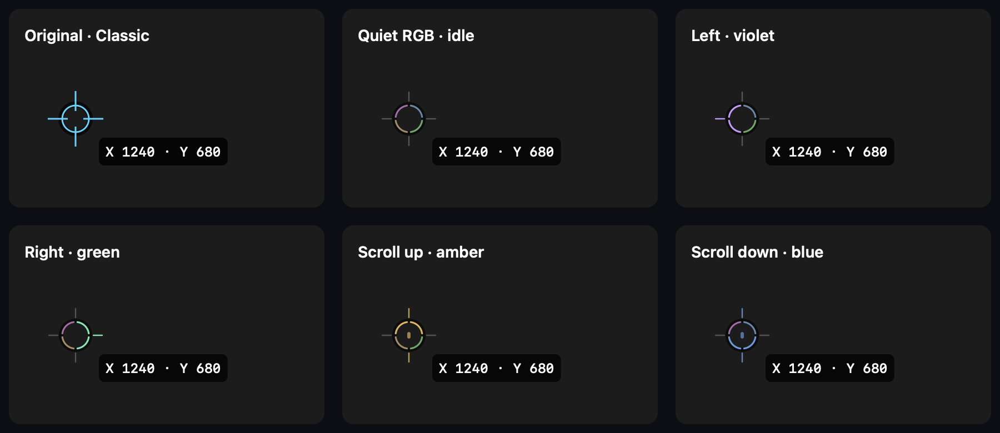

# HID Emu spectrum feedback and companion updates

Date: 2026-11-18, America/Los_Angeles. Mac 2.3.0 build 6, Cardputer ADV 1.4.0, Flipper Zero 1.2.0 (target 7, API 87.1).

## Owner-led design

The owner requested a compact professional interface, reliable Dock artwork, in-app companion updates, and a restrained evolution of the original pointer target. Classic preserves the original. Quiet RGB keeps its small ring and short crosshair; idle color rotates over 16 seconds. Click pulses last about 750 ms, with two pulses for a double click. Scroll activity uses a slow sustained pulse and fade. Target intensity is 10% higher following owner feedback; panel brightness is unchanged.

Fixed spatial anchors are up amber (#FFC961), right green (#66E8AD), down blue (#6EB0FF), left violet (#C799FF). These are base colors before intensity/compositing. Scroll and motion follow the same anchors. The Cardputer uses the same color vocabulary; Flipper's monochrome display uses positions and directional symbols. This convention is a design choice, not a universal color standard. Dashboard origin remains upper-left, X right and Y down, explicitly labeled. Display proportions track the monitor beneath the pointer.

## Code review and efficiency

A shared C/C++ feedback model supplies device direction, event deduplication and pulse timing. Its generated copies are checked against the canonical header. Mac feedback follows the same timing vocabulary, with Reduce Motion support. Repeated snapshots previously risked restarting pulses; sequenced observation messages avoid that. Older companions retain the legacy message path. Host coordinates and observation messages now alternate fairly when both are due, addressing telemetry starvation over a slower link.

Cardputer retains buffered drawing and cached unchanged frames, updating idle animation at eight frames per second while host data is fresh. Flipper uses its existing four-frame-per-second idle refresh. Mac idle animation invalidates only the small target rectangle. Extremely thin radar plots omit the ring to avoid overflowing its bounds. Strict bounded Flipper number parsing replaces conversions that could overflow on oversized commands. None of the display messages execute input or extend arming.

## Companion updater

The Mac includes verified offline packages and optionally checks the repository catalog on launch and every six hours while open. No unattended flashing or operating-system service is installed. Manual Update Device acquires the common controller lock, checks device identity, package size and SHA256, then transfers over USB. Cardputer uses Launcher overwrite in the existing slot, followed by running-version and STOP verification. Flipper checks target/API, backs up its previous FAP on Mac and device, stages the new file and verifies complete readback before and after replacement. Quit/dismiss are blocked during transfer.

Development failures remain part of the record: Launcher CDC initially required an explicit terminal-line handshake. A later complete transfer lost its final reply during reboot despite the old companion starting correctly. The revised flow clears then asserts DTR/RTS and treats complete ACK receipt as tentative until a new running-version/STOP check succeeds. Several bounded preflight attempts stopped before writing. A software return to Launcher left Cardputer USB absent; the owner reconnected its cable before the successful final install. Reset alone did not restore USB in that observed case. Flipper CLI handling was corrected for empty prompts before API inspection. None of these earlier attempts is counted as a successful final updater test.

## Verification scope

Lead-performed review and bounded automated checks cover command bounds and malformed/oversized inputs, queue/arming expiry, release paths and interruption simulation, right-button/double-click mapping, sequence parsing and deduplication, fair telemetry selection, pulse durations/fades/rollover, catalog origin/size/checksum guards, Launcher progress bounds, and Flipper API/readback/replacement guards. Native builds and signature verification supplement these tests; hardware results are recorded separately below.

These checks cannot certify error-free code. Kingshot, sleep/wake, multiple-monitor edge cases and live held-action disconnect qualification remain untested for this release. Older exact-target and interruption qualifications belong to their original versions. Update hashes are transport-integrity checks against this repository catalog, not a separate signed release trust chain. The Mac app uses a local ad-hoc signature, not Developer ID notarization.

## Hardware results

- Installed Mac 2.3.0 build 6 passed native build and strict bundle-signature checks. Both default and compact Display layouts were inspected; all controls and coordinate-origin labels remained visible.
- The final Mac updater installed Flipper 1.2.0 with full staged and installed file readback. Bluetooth reconnect reported 1.2.0, HID ready, held buttons zero and disarmed. STOP restored the normal management interface.
- The final Mac updater installed Cardputer 1.4.0 after a fresh Launcher USB connection. Running-version and STOP replies passed after reboot. Dashboard reconnect reported 1.4.0, HID ready, held buttons zero and disarmed.
- The owner physically tested motion, left/right clicks, double clicks and scrolling against the slightly brighter Mac/Cardputer feedback and replied **“Looks good.”** This is owner-reported visual acceptance, distinct from automated protocol checks.
- Final operation is live Cardputer observation while disarmed; no gameplay or HID action sequence was executed in this final display check. Earlier intermediate safe movement checks do not establish broader release qualification.

[Release files and SHA256 manifest](../releases/hid-emu-2.3/manifest.json). Previous installed Mac bundles, Cardputer full-flash backup and per-update Flipper backups remain local for recovery.
